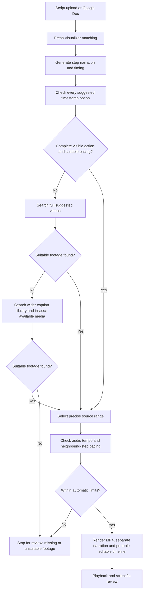

# JoVE Visualize Studio — invited-user pilot

One hosted interface for a numbered script, fresh JoVE Visualizer matching, ElevenLabs narration with timing, staged visual selection, audio pacing, and a Premiere-free draft edit.

## Current status

The local source passes 21 checks, including search-order rules, spreadsheet parsing, invitation and owner access, archive traversal, verified asset-part reconstruction, title-cache restoration, bounded network retries, matching progress, cache invalidation, output-folder validation, actual video rendering, frame counts, and a seven-to-ten-second audio test that preserves a 1 kHz tone's pitch. A headless Streamlit check confirms that missing secure settings keep the application closed before project upload.

An invited owner has signed in on the hosted app. Private library reads and Shared Drive output writes have passed checks, and the first cloud trial has produced fresh matches and all nine narration files and reached visual review. **A completed scientific MP4, uninvited-account rejection, and full cloud resource suitability remain unverified.** This is pilot source, not a production-ready release.

## Workflow



The original caption matcher is retained under `vendor/`. Learned Python-object deserialization and reviewer-memory ranking are disabled in this pilot. Caption results are not treated as visual evidence. Reviewer annotations can be supplied through an optional matching-script workbook.

## Deploy with invited-user access without changing the existing audio application

Use the new public-source `Tej-128/jove-visualize-studio` repository on branch `main` and a separate Streamlit app. The deployment URL can be public; project uploads and results require Google sign-in and an explicitly invited, verified email. Do not replace the existing audio app or change its privacy. This route requires live access-denial checks before company scripts or media are processed.

1. Create a Streamlit app from the new public-source repository, branch `main`. The entry point is `studio/app.py`; choose Python 3.11.
2. The public app must stop at its sign-in gate for anonymous visitors. Add only intended accounts to the application's verified invitation list. Verify that signed-out and uninvited visitors cannot upload scripts, start jobs, or access project status or outputs.
3. Configure secure settings using `studio/.streamlit/secrets.example.toml` as a template. Do not put real keys in GitHub or chat.
4. Register the new app's exact `/oauth2callback` URL in its Google OIDC client. The existing audio application's redirect remains intact.
5. Set `allowed_emails` to the invited accounts. A company-domain address alone is insufficient. The app also requires the verified-email claim.
6. Share the private input library folder with the service account as Viewer. Choose a separate approved output folder inside a company Shared Drive and give the service account permission to create files there. Service accounts cannot own files in personal My Drive. Review inherited Shared Drive access before putting outputs there. Do not enable domain-wide delegation or grant organization-administrator rights.
7. Configure the approved ElevenLabs voice profile and existing API keys. The pilot uses 44.1 kHz PCM; confirm the current ElevenLabs account permits that format before spending generation credits.
8. Complete the checks below before inviting further users.

## Private media library

The private library can also contain `article-title-cache.zip` with a companion `article-title-cache.json`. The descriptor binds its SHA-256 hash to the exact caption-index hash. The ZIP contains only the four permitted `v2_cache` files. This avoids rebuilding thousands of article-title embeddings during the first hosted match. The pilot limits CPU embedding threads to two, reports matching and visual-review step progress, and disables SDK retries inside the already bounded application retry loop. These changes do not lower scientific acceptance thresholds.

An administrator prepares the caption index once using `prepare_library.py`. The runtime never reads a user's Windows folders.

The private Drive input folder contains:

```text
Library/
  index.zip
  sha256sums.json
  Videos/
    original source MP4 files
```

The package script accepts `--index`, `--videos`, and `--output`. The index archive contains only `manifest.json`, `corpus.sqlite`, and `embeddings.npy`. It excludes keys, caches, trained Python objects, and generated customer reports. The existing index already contains the VTT passages used for searching; separately uploading all VTT files is not required for this pilot.

Upload the generated two library files and the original Videos folder through your approved Drive workflow. Put that private folder ID in `LIBRARY_FOLDER_ID`. Use a different folder for `OUTPUT_FOLDER_ID`.

For connectors that cannot transfer large files, `prepare_chunks.py` creates 64 MiB parts and `asset-parts.json`. Upload index parts to Library and video parts to Videos, then upload the manifest after every part succeeds. The app streams the parts back together and verifies the reassembled original checksum. This is a transfer accommodation, not a media conversion. Never keep both a full original video and its split representation active in the same manifest.

The available example library has 30 videos. Results from the larger caption index whose video is absent are explicitly recorded as `media_unavailable`.

## Narration and timing policy

The approved voice/profile speed is supplied correctly in ElevenLabs `voice_settings`. Each step includes neighboring text as context and receives character timing. The original generated narration is retained. Pitch-preserving `atempo` processing fits the audio to the chosen action range.

Automatic post-generation tempo is initially limited to 0.85–1.15. Larger adjustments and adjacent tempo jumps above a 1.2 ratio stop for review. For example, seven seconds into ten requires tempo 0.70 and is deliberately flagged. These are configurable pilot policies, not scientific quality thresholds.

Scientific suitability remains the first criterion. Complete-action ranges are compared for pacing suitability. The app does not invent a missing step, loop footage, silently accept a partial match, or rewrite narration.

Every numbered step currently creates a section boundary. If several script steps belong to a single experiment, explicit section grouping must be added before production use. Dissolves are eight frames, centered on section boundaries, with source handles reserved.

The editable package includes normalized selected shots and adjusted narration with relative paths. It does not require the recipient to have the original server library. It supports further timeline editing, but the prepared shot durations and original video normalization are baked into those media files. Source choices and original in/out times remain in `edit_plan.json`.

## Review and retry limitations

Uncertain or missing footage and unsuitable pacing stop the job with a downloadable report. The current pilot does not yet have a per-step approval/override editor; correct the inputs or selection policy before rerunning. Failed jobs do not automatically bypass review.

Stage records, fresh candidate workbooks and generated narration are saved to a unique private Drive job folder. Runtime status is owner-scoped. The current UI follows jobs in the running container; recovery after a host restart from the saved Drive checkpoints still needs implementation. Provider retries and generation can consume credits; duplicate-request recovery and a currency-based spending guard need validation before production.

## Security checks completed

- Missing configuration closes the app before uploads.
- Only authenticated, verified, explicitly invited emails can submit projects.
- Project status and downloads check the authenticated owner.
- Keys remain in server memory and hosted secure settings.
- Private Drive access uses a scoped service identity with folder-level access.
- Library binaries are checked against administrator-provided SHA-256 hashes.
- Archive path traversal, links, and oversized index expansion are rejected.
- No remotely supplied pickle/joblib model is loaded.
- All media commands use argument arrays; script text is not executable shell code.
- Gemini's preprocessing call is disabled.

These checks do not certify the hosting platform, provider data-retention policy, OAuth deployment, or all application dependencies as vulnerability-free. Live sign-in and access-denial tests are required on the deployed pilot.

## Cloud acceptance checks

1. An uninvited account cannot submit, view a report, or download a project.
2. An invited user cannot access another user's job.
3. The correct Drosophila script yields fresh candidate rows; the organoid workbook is not attached to it.
4. The approved voice and generation speed are audible and returned timing is complete.
5. The attempt log shows all suggested ranges before any broader search.
6. Missing videos and uncertain scientific matches remain flagged.
7. Rendered video frame count, narration coverage, pitch and step boundaries pass checks.
8. The editable archive opens after extraction into a different folder.
9. A host restart demonstrates checkpoint recovery, or the pilot limitation is clearly shown.
10. Existing API credits are used within the agreed limits, without activating new purchases.

## Before-4-PM demo gate

The source and offline checks are prepared. A real shared demo still requires private deployment, secure settings, library upload, and a fresh provider run. Do not label a cached assembly, setup screen, or failed/needs-review job a complete fresh end-to-end demo. The first live run may correctly stop on missing or unsuitable footage.

## Production work remaining

Durable queued workers independent of Streamlit, cloud restart recovery, per-step review and correction controls, calibrated visual acceptance, motion/boundary playback checks, section grouping, complete media coverage, concurrent multi-user load tests, retention/deletion controls, dependency review and pinned builds, and account-level billing safeguards.

For production, retain the same pipeline contracts but put job execution in an approved container-job service rather than relying on a free Streamlit process to survive long renders.

